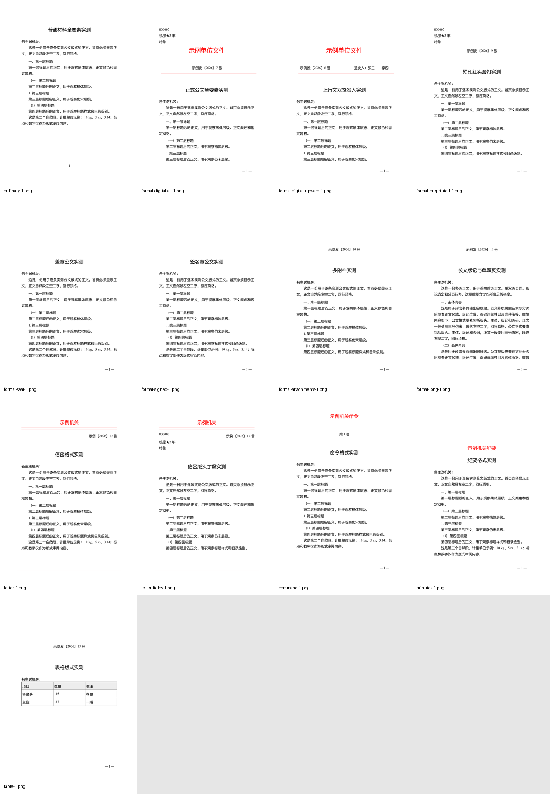

# 公文全案一支笔（Gongwen Yizhibi）


> 公文全流程数字员工：写作 + 排版全案包圆，一条龙交付成稿。
> 面向 **AI Agent 的 skill**（Claude Code / Octop / Coze 等）——不是给人手敲的模板站，装上后说"写一篇调研报告"即触发。



*上图：排版引擎按 GB/T 9704-2012 生成的实拍效果（普通/正式/横排表格版式）。*

## 为什么是它

| 卖点 | 说明 |
|---|---|
| **数据驱动，不是模板** | 从 **226 篇真实公文全量统计**出数值参数：句长、顿号密度、层级配比、力度词配额——公文的"像不像"是可测量的 |
| **写完能验收** | 内置 `check_params.py` 自检器，7 文种（调研报告/领导讲话/工作意见/经验材料/工作方案/经验总结/党建千字材料）跑分出报告，硬冲突必改 |
| **排版符合国标** | 按 **GB/T 9704-2012** 生成 DOCX：版心、字体、标题层级、文号、页码、附件、版记、红头；附校验器逐项 PASS 后才交付 |
| **缺数据不编造** | 占位符机制（`【待补】`/`【示意·待核】`）强制暴露缺口，绝不脑补数字 |

## 安装

依赖：Node.js ≥ 18（排版引擎）、Python 3.x（自检器）。

```bash
git clone https://github.com/xpsmsn/gongwen-yizhibi.git
# 拷贝整个目录到你的 Agent skills 目录，例如：
#   Claude Code:  ~/.claude/skills/gongwen-yizhibi
#   Octop:        <workspace>/skills/gongwen-yizhibi
```

装好后入口是根目录 `SKILL.md`，按任务意图自动路由。

## 快速开始

**一条龙（给要点 → 成品 DOCX）**：对 Agent 说「写一篇 XX 调研报告并排成公文格式」，它会走完整流水线（判文体 → 定参数 → 骨架确认 → 写作 → 自检 → 排版 → 校验）。

**分开跑也行**：

```bash
# 1) 排版：材料 md → 国标 DOCX
node formatting/scripts/generate_gongwen_docx.mjs \
  --input source.md --output out.docx --format ordinary --title "文档标题"

# 2) 校验：13 项版式要素逐项核验
node formatting/scripts/verify_gongwen_docx.mjs --input out.docx --profile ordinary

# 3) 写作自检：文种识别 + 参数偏离报告（Windows 把 python3 换成 python）
python3 writing/scripts/check_params.py draft.md --genre 调研报告
```

## 目录结构

```
SKILL.md                    入口：双引擎路由 + 全流程 + 输出契约
CHANGELOG.md                版本历史
LICENSE.md                  双许可声明
writing/                    写作引擎（lieflat-gongwen）
  ├── 参数卡.md              七文体参数一页表（每次必读）
  ├── 标题技法库.md / 句子对照库.md
  ├── scripts/              check_params.py 自检器 / strip_meta.py
  ├── 公文语料/ 党建语料/     DNA 文档 + _meta 数值统计
  ├── 示例/                  22 篇合成范文
  └── 参考/法定公文样例/      7 篇真实政策文件
formatting/                 排版引擎（gongwen-gbt9704-skill）
  ├── scripts/              generate_gongwen_docx.mjs / verify_gongwen_docx.mjs
  ├── references/           标准执行摘要 / 逐条执行矩阵 / 正式公文核验表
  └── tests/fixture.md       快速验证样例
```

## 来源与许可

| 引擎 | 来源 | 许可 |
|---|---|---|
| 写作引擎 `writing/` | [lieflat-gongwen](https://github.com/larashero3-dotcom/lieflat-gongwen) | PolyForm Noncommercial（非商业） |
| 排版引擎 `formatting/` | [gongwen-gbt9704-skill](https://github.com/mizzlelover/gongwen-gbt9704-skill) | MIT |

双许可合并声明详见 [`LICENSE.md`](LICENSE.md)：整体包按非商业许可提供，**不得售卖、不得用于付费写作服务或集成进商业产品**；商业使用请联系原作者获取授权。
